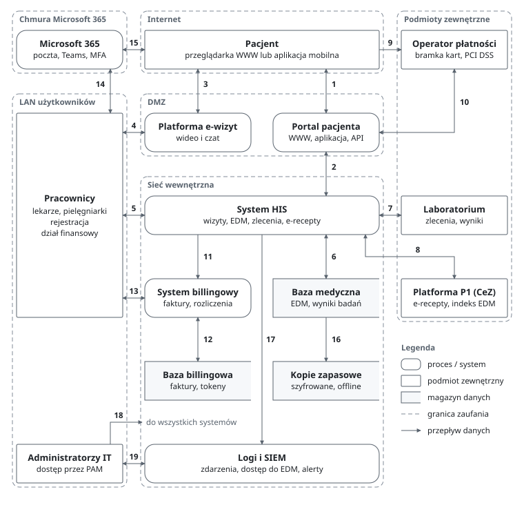

# Projekt architektury bezpieczeństwa IT dla MediHealth Sp. z o.o.

Wybór organizacji, cele biznesowe i diagram przepływu danych (DFD).

## Punkt 1. Wybór organizacji

| Element | Opis |
|---|---|
| Wybór organizacji | MediHealth Sp. z o.o., prywatna sieć placówek medycznych oraz dostawca usług telemedycznych |
| Główna działalność | Świadczenie usług medycznych, prowadzenie portalu pacjenta, realizacja e-wizyt oraz zarządzanie elektroniczną dokumentacją medyczną (EDM) |
| Liczba pracowników | ok. 150 |
| Kluczowe systemy | System HIS (Hospital Information System), portal pacjenta WWW / aplikacja mobilna, baza danych medycznych, system e-mail / Microsoft 365, system billingowy |
| Kluczowe informacje | Dane osobowe i wrażliwe pacjentów (dane medyczne / RODO / EDM), wyniki badań, dane kart płatniczych, dane pracowników, dokumentacja finansowa |
| Cel projektu | Zaprojektowanie bezpiecznej i skalowalnej architektury IT, ze szczególnym uwzględnieniem wysokiej dostępności usług i ścisłej ochrony danych wrażliwych |

## Punkt 2. Definicja celów biznesowych

| Nr | Cel biznesowy |
|---|---|
| CB1 | Zapewnienie ciągłości działania systemów medycznych w trybie 24/7 |
| CB2 | Bezkompromisowa ochrona tajemnicy lekarskiej i danych pacjentów |
| CB3 | Zgodność z wymogami prawnymi i regulacyjnymi (RODO, KSC, normy branżowe) |
| CB4 | Ochrona przed wyciekiem danych oraz atakami typu ransomware |
| CB5 | Minimalizacja ryzyka przestojów operacyjnych |

## Punkt 3. Diagram przepływu danych DFD

DFD (Data Flow Diagram) przedstawia przepływ danych pomiędzy pacjentami, systemami informatycznymi, pracownikami i podmiotami zewnętrznymi. Diagram uwzględnia również administratorów IT oraz granice zaufania pomiędzy siecią firmową a usługami zewnętrznymi.

### 3.1. Elementy diagramu

| Element | Typ | Strefa zaufania | Opis |
|---|---|---|---|
| Pacjent | podmiot zewnętrzny | Internet | Zakłada konto, umawia wizyty, odbywa e-wizyty, pobiera wyniki i płaci online |
| Operator płatności | podmiot zewnętrzny | podmioty zewnętrzne | Przyjmuje dane karty na własnej stronie płatności i zwraca status transakcji |
| Laboratorium | podmiot zewnętrzny | podmioty zewnętrzne | Wykonuje zlecone badania i przekazuje wyniki do HIS |
| Platforma P1 (CeZ) | podmiot zewnętrzny | podmioty zewnętrzne | Krajowa platforma e-zdrowia: e-recepty, e-skierowania, zdarzenia medyczne, indeks EDM |
| Pracownicy | użytkownicy wewnętrzni | LAN użytkowników | Personel medyczny, rejestracja i dział finansowy |
| Administratorzy IT | użytkownicy uprzywilejowani | LAN użytkowników | Zarządzają systemami przez PAM z MFA i obsługują alerty SIEM |
| Portal pacjenta | proces | DMZ | Konto pacjenta w przeglądarce, aplikacji mobilnej i API: rezerwacje, wyniki, dokumenty, płatności |
| Platforma e-wizyt | proces | DMZ | Wideo i czat między pacjentem a lekarzem |
| System HIS | proces | sieć wewnętrzna | Wizyty, EDM, zlecenia, e-recepty, integracje z laboratorium i P1 |
| System billingowy | proces | sieć wewnętrzna | Wycena świadczeń, faktury, rozliczenia, status płatności |
| Microsoft 365 | proces (SaaS) | chmura Microsoft 365 | Poczta, Teams i pliki, tożsamość i MFA pracowników (Entra ID) |
| Logi i SIEM | proces | sieć wewnętrzna | Zbiera logi ze wszystkich systemów, w tym dostęp do EDM, i generuje alerty |
| Baza medyczna | magazyn danych | sieć wewnętrzna | EDM, wyniki badań, dane pacjentów |
| Baza billingowa | magazyn danych | sieć wewnętrzna | Faktury, rozliczenia, tokeny płatności bez numerów kart |
| Kopie zapasowe | magazyn danych | sieć wewnętrzna i kopia offline | Szyfrowane kopie baz, w tym co najmniej jedna kopia offline lub niezmienialna |

Przyjęto, że laboratorium jest partnerem zewnętrznym, a dane kart płatniczych są wprowadzane wyłącznie na stronie operatora płatności. MediHealth przechowuje tylko token i status transakcji.

### 3.2. Diagram DFD

Linie przerywane oznaczają granice stref zaufania. Numery strzałek odpowiadają przepływom z punktu 3.3. Plik do edycji w draw.io: [diagramy/dfd.drawio](diagramy/dfd.drawio).

### 3.3. Opis przepływu danych

| Nr | Przepływ | Przesyłane dane | Kanał i zabezpieczenie |
|---|---|---|---|
| 1 | Pacjent i portal pacjenta | do portalu: dane konta, logowanie, rezerwacje; do pacjenta: terminy, wyniki, dokumenty | HTTPS (TLS 1.2+), WAF, MFA dla konta pacjenta |
| 2 | Portal pacjenta i system HIS | do HIS: rezerwacje, dane pacjenta; do portalu: terminy, wyniki i dokumenty | API przez zaporę między DMZ a siecią wewnętrzną, mTLS, tylko niezbędne pola |
| 3 | Pacjent i platforma e-wizyt | obraz, dźwięk, czat, załączniki | WebRTC z szyfrowaniem DTLS-SRTP, jednorazowy link do pokoju wizyty |
| 4 | Lekarz i platforma e-wizyt | obraz, dźwięk, czat | jak w przepływie 3, pokój dostępny tylko dla zalogowanego lekarza (MFA) |
| 5 | Pracownicy i system HIS | wpisy do EDM, rozpoznania, zlecenia, e-recepty, rejestracja pacjentów | z LAN przez zaporę do strefy systemów, konta imienne, role (RBAC) |
| 6 | System HIS i baza medyczna | zapis i odczyt EDM oraz wyników badań | połączenie wewnętrzne, szyfrowanie bazy (TDE), konto techniczne z minimalnymi uprawnieniami |
| 7 | System HIS i laboratorium | do laboratorium: zlecenia badań; do HIS: wyniki badań | HL7/FHIR przez VPN site-to-site lub mTLS |
| 8 | System HIS i platforma P1 | do P1: e-recepty, e-skierowania, zdarzenia medyczne, indeks EDM; do HIS: kody i potwierdzenia | TLS z certyfikatem podmiotu, podpisane dokumenty |
| 9 | Od pacjenta do operatora płatności | dane karty płatniczej | strona płatności operatora (HTTPS), dane karty nie trafiają do MediHealth |
| 10 | Portal pacjenta i operator płatności | do operatora: kwota i numer zamówienia; do portalu: status transakcji, token | API operatora, podpisane powiadomienia (webhook) z weryfikacją podpisu |
| 11 | Od systemu HIS do systemu billingowego | wykonane świadczenia, status płatności | integracja wewnętrzna, kontrola kompletności rozliczeń |
| 12 | System billingowy i baza billingowa | faktury, rozliczenia, tokeny płatności | połączenie wewnętrzne, szyfrowanie bazy |
| 13 | Pracownicy i system billingowy | faktury, raporty finansowe, płatności w rejestracji | konta imienne, role finansowe, MFA |
| 14 | Pracownicy i Microsoft 365 | poczta, Teams, pliki | TLS, MFA i dostęp warunkowy (Entra ID), DLP |
| 15 | Microsoft 365 i pacjent | powiadomienia, np. o nowym wyniku w portalu, oraz korespondencja e-mail | TLS, treść bez danych medycznych, dokumenty tylko przez portal |
| 16 | Od bazy medycznej do kopii zapasowych | kopie baz, także bazy billingowej | szyfrowanie, reguła 3-2-1 z kopią offline lub niezmienialną, testy odtwarzania |
| 17 | Od systemu HIS do SIEM | logi dostępu do EDM i zdarzeń ze wszystkich systemów | osobny kanał logów, ochrona przed modyfikacją, określona retencja |
| 18 | Od administratorów IT do sieci wewnętrznej | sesje administracyjne do wszystkich systemów | PAM (bastion) z MFA i nagrywaniem sesji, osobne konta uprzywilejowane |
| 19 | SIEM i administratorzy IT | do administratorów: alerty; do SIEM: obsługa i zamykanie incydentów | konsola SIEM dostępna tylko dla administratorów, MFA |

### 3.4. Wymagania bezpieczeństwa wynikające z DFD

Wymagania pogrupowano w osiem obszarów. Kolumna „Cele” wskazuje cele biznesowe z punktu 2.

| Obszar | Wymaganie | Przepływy | Cele |
|---|---|---|---|
| Poufność | Szyfrowanie TLS 1.2+ na każdym przepływie przekraczającym granicę strefy, szyfrowanie baz (TDE) i kopii, e-maile do pacjentów bez danych medycznych, DLP w Microsoft 365 | 1-5, 7-10, 14-16 | CB2, CB4 |
| Integralność | Podpisywanie dokumentów EDM, walidacja komunikatów HL7/FHIR i danych z portalu, dziennik zmian w EDM (kto, co, kiedy), weryfikacja podpisu powiadomień od operatora płatności | 2, 5-8, 10, 11 | CB2, CB3 |
| Dostępność | Klaster HIS i bazy medycznej z replikacją do drugiej lokalizacji, ochrona DDoS portalu i e-wizyt, kopie wg reguły 3-2-1 z kopią offline i testami odtwarzania, procedury pracy awaryjnej placówek | 1-3, 6, 16 | CB1, CB5 |
| Kontrola dostępu | Konta imienne, MFA dla pracowników i pacjentów, role w HIS wg zasady najmniejszych uprawnień, dostęp awaryjny („break-the-glass”) z rejestrowaniem, PAM dla administratorów, kwartalny przegląd uprawnień | 1, 4, 5, 13, 14, 18 | CB2, CB3 |
| Segmentacja sieci | Podział na strefy: Internet, DMZ (WAF, reverse proxy), sieć wewnętrzna, LAN użytkowników i partnerzy. Ruch między strefami tylko przez zapory z regułą „domyślnie blokuj”, połączenia z laboratorium i P1 tylko z dozwolonych adresów | wszystkie przekraczające granice stref | CB2, CB4 |
| Monitorowanie | Centralne logi w SIEM, w tym każdy odczyt EDM, alerty na nietypowe zdarzenia (masowy eksport, logowanie z nowej lokalizacji), EDR na stacjach i serwerach, obsługa incydentów 24/7 | 17, 19 | CB1, CB4 |
| Ochrona danych kart | Dane karty tylko na stronie operatora płatności. MediHealth przechowuje token i status transakcji, co ogranicza zakres PCI DSS do minimum (SAQ A) | 9, 10, 12 | CB2, CB3 |
| Zgodność | Rejestr czynności przetwarzania i DPIA dla danych o zdrowiu (art. 9 i 35 RODO), umowy powierzenia z dostawcami przetwarzającymi dane, np. Microsoft (art. 28 RODO), zgłaszanie naruszeń do UODO w 72 h (art. 33 RODO), przechowywanie EDM przez 20 lat od końca roku ostatniego wpisu (art. 29 ustawy o prawach pacjenta), zarządzanie ryzykiem i ciągłość działania zgodnie ze znowelizowaną ustawą o KSC, obowiązującą od 3 kwietnia 2026 r., z terminem dostosowania do 3 kwietnia 2027 r. | 6-8, 14, 16 | CB3 |

Do ustalenia pozostaje, czy MediHealth będzie w KSC podmiotem kluczowym, czy ważnym, ponieważ od tego zależą m.in. obowiązkowe audyty.

### 3.5. Podsumowanie

Diagram DFD przedstawia główne przepływy informacji w MediHealth Sp. z o.o. i wskazuje systemy, które przetwarzają dane pacjentów, dokumentację medyczną i dane finansowe. Dane medyczne skupiają się w systemie HIS i bazie medycznej, a dostęp do nich prowadzi przez sześć stref zaufania. Najbardziej narażone są przepływy przekraczające granice stref, zwłaszcza połączenia z Internetu (1, 3, 9), wymiana danych z partnerami (7, 8, 10) oraz dostęp administracyjny (18). Diagram jest podstawą do dalszego projektowania architektury IT, identyfikacji zasobów, określenia zagrożeń i analizy ryzyka.

## Źródła

- Ustawa o prawach pacjenta i Rzeczniku Praw Pacjenta, art. 29: [arslege.pl](https://arslege.pl/przechowywanie-dokumentacji-medycznej/k478/a41973/)
- Harmonogram wdrożenia znowelizowanej ustawy o KSC: [itwiz.pl](https://itwiz.pl/nowelizacja-ustawy-o-ksc-zaczyna-obowiazywac-rusza-harmonogram-wdrozenia-nis2-w-polsce/)
